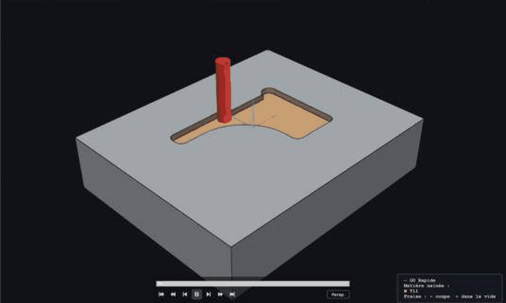
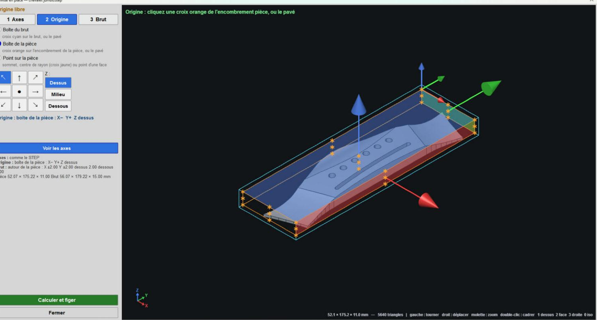
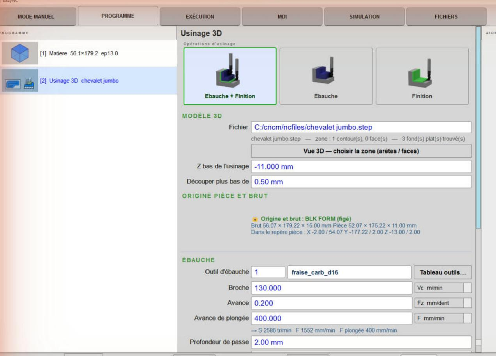

# EazySmartNC

🇫🇷 [Version française](README.fr.md)

**Conversational CAM for Centroid CNC12, in the spirit of Heidenhain SmartNC.**

EazySmartNC (application *EazyNC*) lets you program a CNC mill **without writing G-code**: you fill in blocks (stock, pockets, drilling, profiles…), the software computes the toolpaths, simulates them in 3D and generates a `.nc` program ready for **Centroid CNC12** (Acorn, AcornSix, Oak…).

Written in C++ / Qt 6 by a machinist, for machinists.

> The user interface is currently in French.

> [!WARNING]
> **Testing stage.** EazySmartNC is still under development and testing. Always check the program in simulation before machining, and run the first pass with care (reduced feed, safe Z).
>
> **Developer's test setup:** Intel Core i3-12100F, 16 GB RAM, NVIDIA RTX 3060 graphics card, Windows 11, Centroid CNC12 Acorn Mill v5.42.10 with an Acorn board.
>
> Not yet tried on lower-end PCs: with integrated graphics (Intel, AMD) or little memory, 3D simulation and 3D toolpath computation may be slow. An up-to-date graphics driver (OpenGL) is required.
>
> **Link with CNC12 (Centroid API):** the API calls have been fixed, and EazyNC can now load the program into CNC12. No machining test has been done with this link yet. Further fixes to the API calls are planned in the near future.



---

## Overview

### Contour pocket with islands

One line per contour: **Pocket** or **Island**, with start Z and depth. The order of the list matters, like layers. The cycle splits the height into bands at every level (pocket floors, island tops) and computes the area to clear at each pass.


### DXF converter

Pick a contour with one click (automatic chaining, cutting direction, TNC-style element checkboxes) and select drilling positions with a window, with a diameter filter.


### Animated 3D help

Each input field shows a short 3D animation in the HELP panel: plunge modes, depth per pass, approach and clearance planes, stepover, side and floor stock, climb / conventional, entry radius, hole milling… Round pockets get round animations. The animations are rendered by a small Python tool included in `tools/anim3d`.


### 3D machining from a STEP file

Set up the part Fusion-style, in three steps: pick the machine axes by clicking faces of the part box (the third axis is deduced, the origin never moves), choose the origin on the stock box, on the part box (3×3 pad + top / middle / bottom) or on any point of the part, then define the stock around the part or with fixed dimensions. "Compute and lock" fills the BLK FORM.




The 3D Machining block then roughs layer by layer (one contour per layer, from the stock) and finishes layer by layer with the ball-nose cutter, using the locked origin and stock of the BLK FORM.



### 3D simulation

Real-time stock removal, one color per tool, line-by-line G-code playback.


---

## Features

**Block programming**
- Stock definition (BLK FORM) with parameters inherited by every block: approach Z, clamp clearance, linking Z, work offset.
- Select, copy, cut and insert several blocks.
- Files: `.enc` (program), `.cnt` (contours) and `.pnt` (point patterns).

**Cycles**
- Rectangular and circular pockets.
- **Contour pocket** with islands, stepped pockets, islands below the top surface, and a start Z per contour.
- Profile milling: outside with adaptive roughing from the stock, or R0 / RL / RR. Perpendicular, arc or tangent-line lead-in and lead-out.
- Helical hole milling (boring).
- Drilling and peck drilling, spot drilling, reaming.
- Tapping (not tested: requires a spindle encoder).
- Straight, helical or ramp plunge, with its own ramp feed.
- Separate roughing and finishing: side and floor stock, floor and wall finishing.
- Climb or conventional milling.
- Cutter compensation computed by EazyNC (Clipper2): the G-code stays in G40.

**Tools and import**
- Tool table: radius, number of flutes, ramp angle. Feeds in mm/min, mm/rev or mm/tooth, and cutting speed.
- DXF converter: contours, positions, origin, mm/inch, chaining tolerance.
- Optional STEP/IGES import via OpenCASCADE.

**Simulation and machine**
- 3D simulation (OpenGL) with a per-tool legend.
- Manual, Run and MDI pages connected to CNC12 through the Centroid API (optional).

---

## Building

**Tested environment**: Windows 11, **Qt 6.8 (MSVC 2022, 64-bit)**, Qt Creator, on an Intel Core i3-12100F, 16 GB RAM, NVIDIA RTX 3060, with Centroid CNC12 Acorn Mill v5.42.10.

1. Clone the repository and open `EazyNC.pro` in Qt Creator.
2. **TNC icons**: they are not included (see below). Create placeholder icons so the project compiles:
   ```
   pip install pillow
   python tools/generer_icones_provisoires.py
   ```
3. Build and run (kit *Desktop Qt 6.8 MSVC2022 64bit*).
4. Copy `eazync.msg` into a `lang/` folder next to the executable: it holds the interface texts.

**qmake options** (*Projects > Build > qmake > Additional arguments*)
- `CONFIG+=WITH_OCC`: STEP/IGES import. Requires OpenCASCADE via vcpkg; adjust `VCPKG_ROOT` in `EazyNC.pro`.
- `DEFINES+=WITH_CENTROID_API`: real-time link with CNC12. Requires the `CentroidWrapper` (sources in `CentroidWrapper/`) and the Centroid API DLL, which comes with the CNC12 installation.

Without these options, EazyNC runs standalone: programming, simulation and `.nc` generation.

---

## Resources not included

The repository is public. These items belong to Heidenhain and are **not** published:

| Item | Effect | What to do |
|---|---|---|
| Font `TNC640Global.ttf` | The interface uses a fallback font | Nothing required. If you have the font, put it at the project root. |
| Icons `icons/unit/` (94 files, TNC style) | `icons.qrc` does not compile without them | Run `tools/generer_icones_provisoires.py`, or supply your own icons (list in `docs/icones-tnc-a-fournir.txt`). |

---

## Code layout

```
EazyNC.pro                 Qt project
mainwindow.*               main window, softkeys, navigation
programmepage.*            block list, G-code generation
uniteditor.* / UnitEditor.ui   block input pages
cycles/                    cycle generators (one file per cycle)
gcodeengine.*              program header and footer, data structures
clipper2/ clipper2utils.*  offsets and boolean operations (Clipper2)
cadviewwidget.* cadimporter.*   DXF / STEP converter
sim3dwidget.* simulationpage.h  3D simulation
tooldatabase.* tooltabledialog.*  tool table
modules/ CentroidWrapper/  link with CNC12 (optional)
icons/                     icons and help images
docs/images/               screenshots for this README
```

---

## Roadmap

- [ ] Pre-drilling cycle (pilot holes for straight plunge)
- [x] Climb / conventional in the profile cycle
- [x] Animated 3D help for the input fields
- [ ] STEP 3D view: origin from faces and edges, spline recognition
- [ ] Inch mode (G20)
- [ ] English interface
- [ ] Reorganize the code into `src/`, `ui/`, `resources/`

---

## Contributing

Feedback from machinists and developers is welcome: open an *Issue* for a bug or a cycle idea, or a *Pull Request*.

Developer: **JB**, CNC machinist (Heidenhain TNC 530 / 620 / 640).
