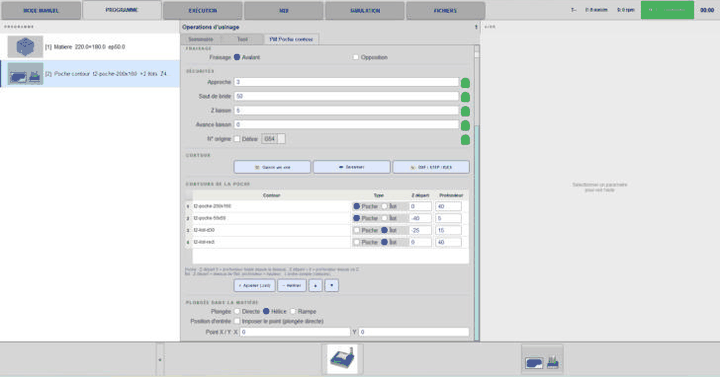
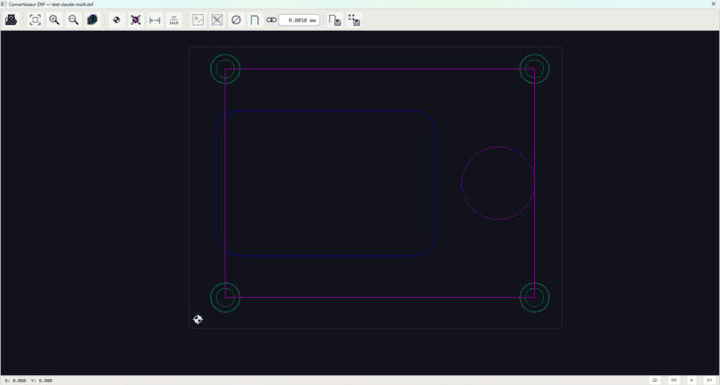
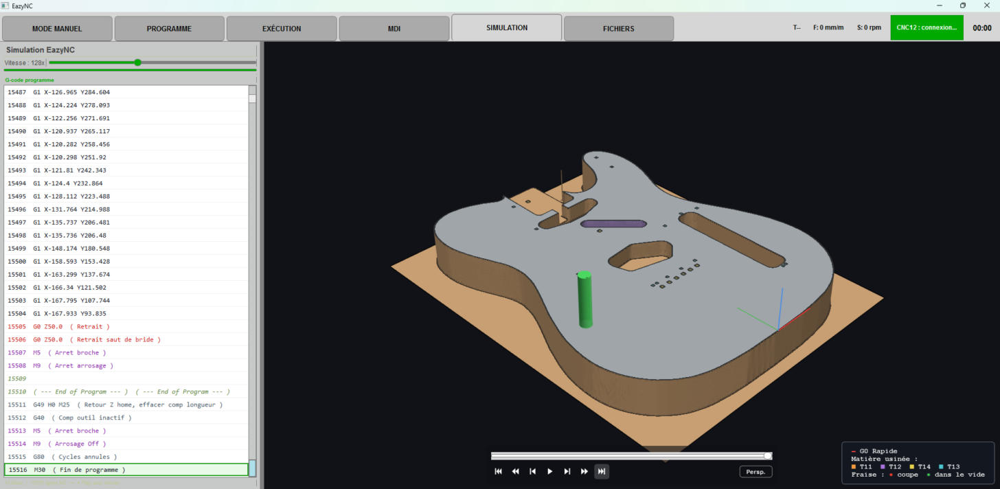

# EazySmartNC

**FAO conversationnelle pour Centroid CNC12, dans l'esprit du SmartNC Heidenhain.**

EazySmartNC (application *EazyNC*) permet de programmer une fraiseuse CNC **sans écrire de G-code** : on remplit des blocs (matière, poches, perçages, contournages…), le logiciel calcule les trajectoires, les simule en 3D et génère un programme `.nc` prêt pour **Centroid CNC12** (Acorn, AcornSix, Oak…).

Écrit en C++ / Qt 6 par un fraiseur, pour des fraiseurs.


---

## Aperçu

### Poche de contour avec îlots

Une ligne par contour : **Poche** ou **Îlot**, avec Z départ et profondeur. L'ordre de la liste compte, comme des calques. Le cycle découpe la hauteur en tranches à chaque cote (fonds de poche, dessus d'îlots) et calcule la zone à vider à chaque passe.



### Convertisseur DXF

Sélection d'un contour d'un clic (enchaînement automatique, sens d'usinage, éléments à cocher façon TNC) et des positions de perçage au cadre, avec un filtre par diamètre.



### Simulation 3D

Enlèvement de matière en temps réel, une couleur par outil, lecture ligne à ligne du G-code.



---

## Fonctionnalités

**Programmation par blocs**
- Matière (BLK FORM) avec paramètres hérités par tous les blocs : Z approche, saut de bride, Z liaison, origine.
- Sélection, copie, coupe et insertion de plusieurs blocs.
- Fichiers `.enc` (programme), `.cnt` (contours) et `.pnt` (modèles de points).

**Cycles**
- Poche rectangulaire et poche circulaire.
- **Poche de contour** avec îlots, poches étagées, îlots plus bas que la surface, et Z départ par contour.
- Contournage : extérieur avec ébauche adaptative depuis le brut, ou R0 / RL / RR. Entrées et sorties perpendiculaires, en arc ou en ligne tangente.
- Fraisage de trou (alésage hélicoïdal).
- Perçage simple et débourrage, pointage, taraudage, alésage.
- Plongée directe, en hélice ou en rampe, à l'avance pendulaire.
- Ébauche et finition séparées : surépaisseurs latérale et fond, finition des fonds et des parois.
- Avalant ou opposition.
- Compensation calculée par EazyNC (Clipper2) : le G-code reste en G40.

**Outils et import**
- Table d'outils : rayon, nombre de dents, angle de rampe. Avances en mm/min, mm/tr ou mm/dent, et vitesse de coupe.
- Convertisseur DXF : contours, positions, origine, mm/pouce, tolérance d'enchaînement.
- Import STEP/IGES optionnel via OpenCASCADE.

**Simulation et machine**
- Simulation 3D (OpenGL) avec légende par outil.
- Pages Mode manuel, Exécution et MDI reliées à CNC12 via l'API Centroid (optionnel).

---

## Compilation

**Environnement testé** : Windows 10/11, **Qt 6.8 (MSVC 2022, 64 bits)**, Qt Creator.

1. Cloner le dépôt et ouvrir `EazyNC.pro` dans Qt Creator.
2. **Icônes TNC** : elles ne sont pas fournies (voir plus bas). Créer des icônes provisoires pour que le projet compile :
   ```
   pip install pillow
   python tools/generer_icones_provisoires.py
   ```
3. Compiler et lancer (kit *Desktop Qt 6.8 MSVC2022 64bit*).
4. Copier `eazync.msg` dans un dossier `lang/` à côté de l'exécutable : ce sont les textes de l'interface.

**Options qmake** (*Projets > Build > qmake > Arguments supplémentaires*)
- `CONFIG+=WITH_OCC` : import STEP/IGES. Nécessite OpenCASCADE via vcpkg ; adapter `VCPKG_ROOT` dans `EazyNC.pro`.
- `DEFINES+=WITH_CENTROID_API` : liaison temps réel avec CNC12. Nécessite le wrapper `CentroidWrapper` (sources dans `CentroidWrapper/`) et la DLL de l'API Centroid, fournie avec l'installation de CNC12.

Sans ces options, EazyNC fonctionne en mode autonome : programmation, simulation et génération du `.nc`.

---

## Ressources non incluses

Le dépôt est public. Ces éléments appartiennent à Heidenhain et ne sont **pas** publiés :

| Élément | Effet | Que faire |
|---|---|---|
| Police `TNC640Global.ttf` | L'interface utilise une police de remplacement | Rien d'obligatoire. Si vous disposez de la police, placez-la à la racine du projet. |
| Icônes `icons/unit/` (94 fichiers, style TNC) | `icons.qrc` ne compile pas sans elles | Lancer `tools/generer_icones_provisoires.py`, ou fournir vos propres icônes (liste dans `docs/icones-tnc-a-fournir.txt`). |

---

## Organisation du code

```
EazyNC.pro                 projet Qt
mainwindow.*               fenêtre principale, softkeys, navigation
programmepage.*            liste des blocs, génération du G-code
uniteditor.* / UnitEditor.ui   pages de saisie des blocs
cycles/                    générateurs de cycles (un fichier par cycle)
gcodeengine.*              en-tête et fin de programme, structures de données
clipper2/ clipper2utils.*  calcul des décalages et booléens (Clipper2)
cadviewwidget.* cadimporter.*   convertisseur DXF / STEP
sim3dwidget.* simulationpage.h  simulation 3D
tooldatabase.* tooltabledialog.*  table d'outils
modules/ CentroidWrapper/  liaison avec CNC12 (optionnel)
icons/                     icônes et images d'aide
docs/images/               captures de ce README
```

---

## Feuille de route

- [ ] Cycle de pré-perçage (avant-trous pour la plongée directe)
- [ ] Avalant / opposition dans le cycle de contournage
- [ ] Vue 3D STEP : origine par faces et arêtes, reconnaissance des splines
- [ ] Mode pouce (G20)
- [ ] Réorganisation du code en `src/`, `ui/`, `resources/`

---

## Contribuer

Les retours de fraiseurs et de développeurs sont les bienvenus : ouvrez une *Issue* pour un bug ou une idée de cycle, ou une *Pull Request*.

Développeur : **JB**, fraiseur sur commande numérique (Heidenhain TNC 530 / 620 / 640).
